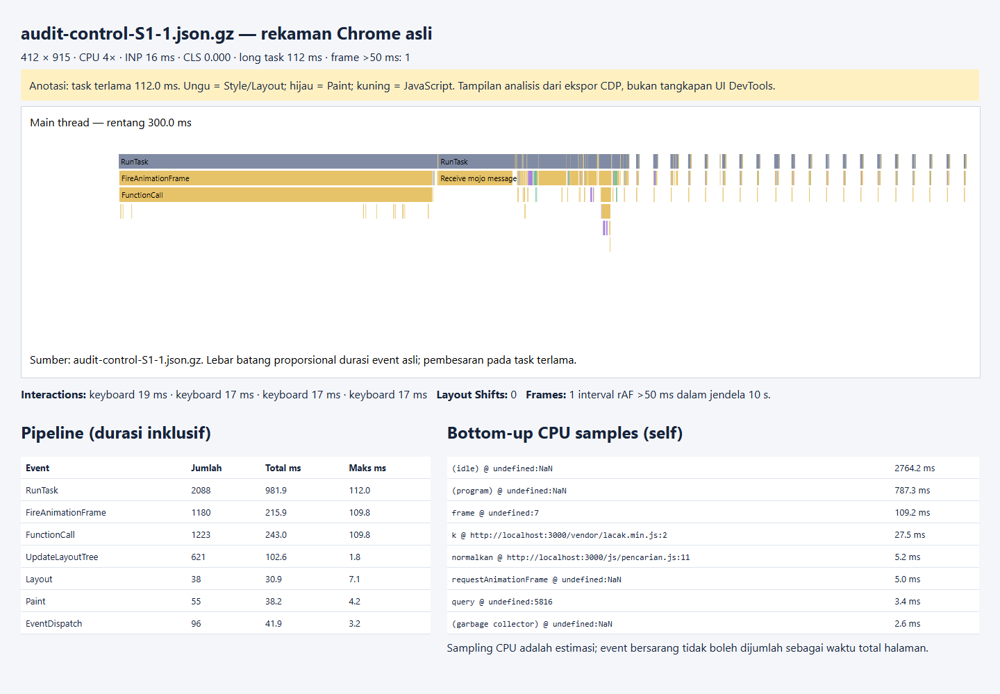
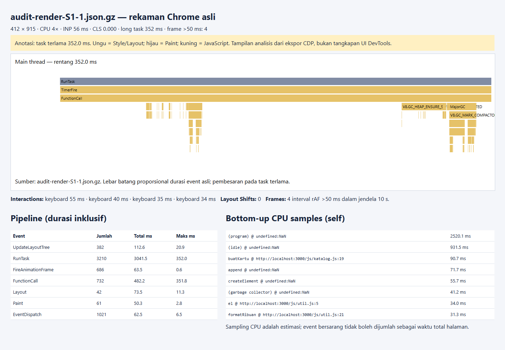
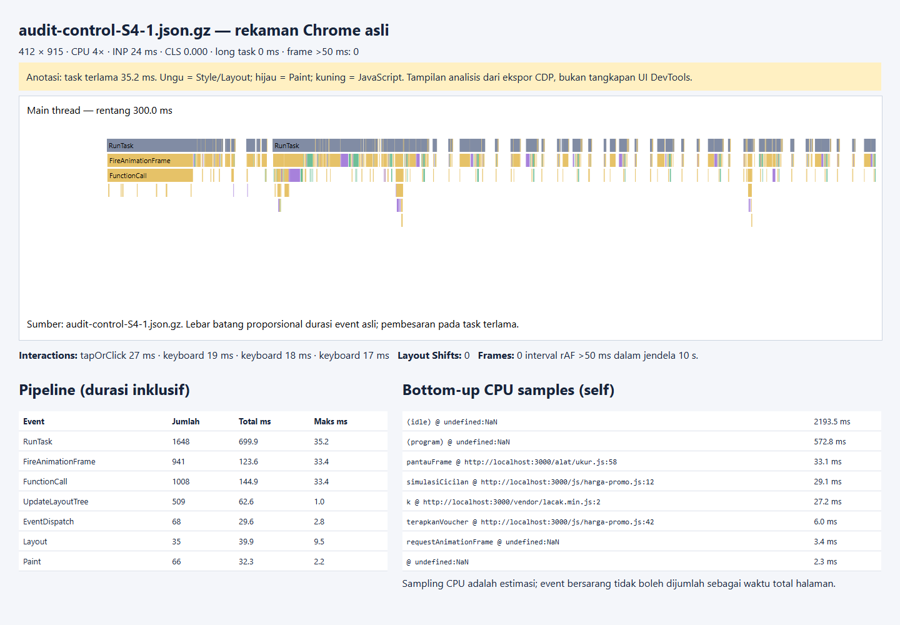
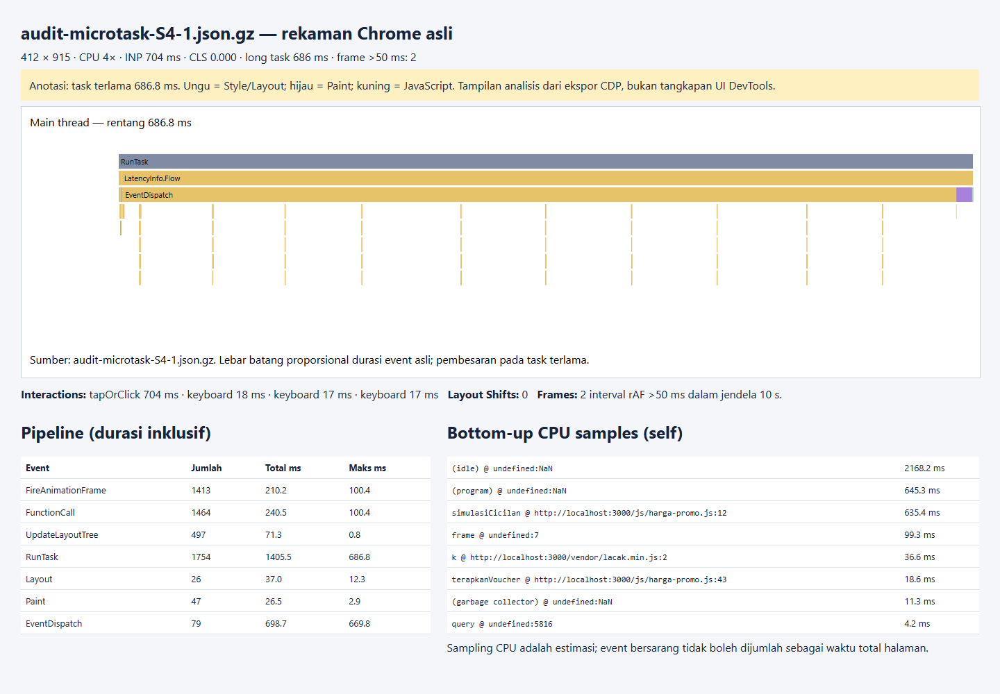

# Audit usulan perbaikan dari AI

AI: **OpenAI Codex**. Basis kandidat: commit `dcc5f7a`. Kandidat dan pertanyaan evaluasi: [PROPOSALS.md](audit-candidates/PROPOSALS.md). Tidak dibuat percakapan AI kedua atau reviewer manusia fiktif: agen yang sama membuat alternatif terbatas dan menjalankan audit otomatis. Mahasiswa harus meninjau bukti serta menulis/menjelaskan pemahamannya sendiri sebelum pengumpulan.

Semua eksperimen memakai Chrome 154, 1500 produk, CPU 4×, 412 × 915, tiga ulangan. Browser menerima satu modul kandidat melalui routing Playwright; aplikasi kerja tidak diganti. Kontrol `audit-control` memakai kode kerja tanpa kandidat. Raw data, sumber modul, dan trace disimpan agar eksperimen dapat direproduksi. Baseline asli juga tersedia, tetapi perbandingan kausal kandidat menggunakan kontrol yang sama.

## A-01: Content-visibility belum menghilangkan biaya pembuatan DOM

- **Tiket yang diminta diperbaiki:** TK-1041.
- **Prompt/pertanyaan evaluasi:** “Bisakah content-visibility: auto menggantikan virtualisasi sehingga pencarian lebih sederhana?” Pertanyaan dirumuskan Codex dalam pelaksanaan permintaan audit pengguna, bukan kutipan percakapan terpisah.
- **Usulan AI:** tetap debounce 150 ms, tetapi buat semua kartu pada setiap hasil. [Modul yang diuji](audit-candidates/audit-render-katalog.js).

```js
for (const produk of daftar) {
  const kartu = buatKartu(produk);
  Object.assign(kartu.style, {
    position: 'relative', contentVisibility: 'auto',
    containIntrinsicSize: '508px'
  });
  kisi.append(kartu); amatiKartu(kartu);
}
```

- **Jenis masalah:** [x] Tidak lengkap; [x] regresi task/kapasitas DOM dibanding kontrol. Bukan kesalahan pada aturan harga.
- **Bukti:** kandidat S1 INP **56 ms**, long task **310 ms** (ulangan: 352, 258, 310 ms). Kontrol S1 INP **16 ms**, long task panel **106 ms**. Dalam kontrol, outlier 106 ms berasal dari probe pengukuran `frame` ber-URL kosong; kandidat tetap menunjukkan task pembuatan DOM 258–352 ms. Jangan menyatakan bahwa seluruh 106 ms adalah biaya aplikasi. Baseline asli S1 adalah INP 2544 ms/long task 2104 ms: kandidat membantu, tetapi belum memenuhi batas task 100 ms.
- **Trace:** [kontrol](trace/audit-control-S1-1.json.gz), [kandidat](trace/audit-render-S1-1.json.gz), [semua angka kandidat](data/audit-render/summary.json). Flame chart dan samples menunjukkan `buatKartu`, `append`, dan `createElement`.





- **Mengapa usulan keliru:** melewati render konten offscreen tidak melewati JavaScript pembuat elemen, alokasi DOM, dan pendaftaran observer. INP saja juga tidak menangkap seluruh pekerjaan debounce yang muncul sesudah ketikan.
- **Perbaikan yang dipilih:** pertahankan data lengkap, buat hanya jendela kartu di viewport, gunakan CSS untuk ukuran judul, observer untuk gambar/impresi. Harga yang dibayar: kompleksitas posisi baris, fokus, dan pengujian resize.

## A-02: Chunk microtask tidak memberikan kesempatan menggambar

- **Tiket yang diminta diperbaiki:** TK-1057.
- **Prompt/pertanyaan evaluasi:** “Bisakah semua perhitungan asli dipertahankan dan chunk diberi await Promise.resolve agar UI responsif?”
- **Usulan AI:** pertahankan 40 simulasi yang semula ada dan hanya ganti batas chunk menjadi microtask. [Modul yang diuji](audit-candidates/audit-microtask-harga-promo.js).

```js
const beriWaktuRender = () => Promise.resolve();
// di perhitungan setiap produk:
for (let i = 0; i < 40; i++) simulasiCicilan(hargaAkhir + i);
// di akhir chunk:
await beriWaktuRender();
```

- **Jenis masalah:** [x] Salah mekanisme; [x] tidak lengkap; [x] regresi respons/progres dibanding kontrol.
- **Bukti:** kandidat S4 INP median **704 ms**, long task **686 ms** (INP: 704, 1184, 688 ms). Ketiga ulangan merekam **0 frame progres** dan **0 input selama perhitungan**. Kontrol S4 INP **24 ms**, tidak mencatat long task >=50 ms; setiap ulangan menangkap 16 nilai progres dan tiga input saat perhitungan aktif. Tes oracle terpisah juga memverifikasi 3028 hasil harga/cicilan pada implementasi kerja.
- **Trace:** [kontrol](trace/audit-control-S4-1.json.gz), [kandidat](trace/audit-microtask-S4-1.json.gz), [data lengkap](data/audit-microtask/summary.json). `simulasiCicilan` mendominasi samples kandidat; tidak ada kesempatan paint di antara chunk microtask.





- **Mengapa usulan keliru:** Promise yang langsung selesai melanjutkan microtask pada giliran yang sama; browser menguras antrean tersebut sebelum rendering opportunity. `async` menjelaskan penjadwalan kelanjutan, bukan pemindahan CPU ke thread lain.
- **Perbaikan yang dipilih:** simulasi final tetap dihitung, hasil 40 panggilan yang dibuang dihapus setelah uji oracle; chunk <=100 produk dengan anggaran 4 ms dan jeda task 16 ms. Peta harga baru diterapkan atomik setelah seluruh produk selesai.

## Refleksi (di bawah 200 kata)

AI membantu menelusuri hubungan antar modul, menulis harness yang dapat diulang, dan membandingkan hasil bisnis secara menyeluruh. Namun nama API tidak cukup untuk membuktikan mekanisme: content-visibility tidak menghapus alokasi DOM dan await tidak selalu memberi waktu render. Pengukuran pun harus diaudit. Probe rAF tambahan buatan agen menimbulkan outlier sekitar 106 ms; trace menunjukkan URL kosong dan fungsi probe, sehingga probe dihapus sebelum seri akhir. Data antara tetap disimpan, bukan diam-diam diganti. Audit ini adalah analisis otomatis yang transparan, bukan bukti bahwa seorang mahasiswa sudah memahami flame chart. Mahasiswa perlu membuka trace asli, memeriksa hubungan task/microtask/pipeline, dan mampu menjelaskan trade-off tanpa AI pada sesi individu.
